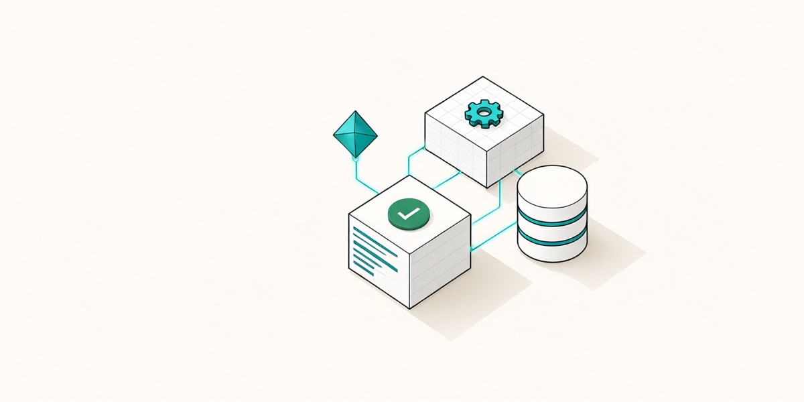

# IaC Genius Community Edition

Describe the infrastructure you want in plain English. IaC Genius writes the Terraform (or OpenTofu),
runs the real validators over it, fixes what it can within a fixed budget, and hands you a pull request
to review. It runs on [Hermes Agent](https://github.com/NousResearch/hermes-agent).

It never applies anything. You remain the one who runs `terraform apply`, somewhere else, after you have
read the diff. The desk holds no cloud credentials and does not need them to validate.

## How it works

Ask for something like "a private RDS database with customer-managed encryption." The desk writes down
what you said in a decision ledger, then asks the few questions that actually cost money or cannot be
undone before it spends anything. It pins the Terraform and provider versions and checks every resource
argument against the real provider schema (`terraform providers schema -json`) instead of guessing. There
is no template catalog here; grounding comes from that schema and from read-only registry knowledge (the
Terraform MCP, AWS Knowledge MCP, DeepWiki).

Then it generates the stack and runs the toolchain: `terraform validate`, `tflint`, `checkov`, and a secret
scan. Correctness problems block. Security findings are yours to accept or fix, by name; the desk will not
quietly pass them. It repairs within a bounded budget, then stops and asks a person. Everything it did
shows up on a board with the tool, the version, and the result. A scanner that did not run is marked
`NOT_RUN`, never `PASS`.

When you are happy, it opens a PR whose body is the decision ledger, and reads the commit back to confirm
it landed.

## Your work, kept in one folder

Each mission is one folder. The generated `.tf` files sit at the top. A separate `work/` folder keeps what
was decided and who decided it: the ledger, the frozen build sheet, the validation evidence, the named
acceptances. A `README` in the folder explains how to pick it up again later. Ask the desk to `package` a
mission and it zips the whole folder, so you can download it from the dashboard Files tab and explore it
offline.

## What it never does

- Run `terraform apply` / `tofu apply`, or call any cloud write API.
- Use cloud credentials. Validation needs none.
- Claim a scan passed when it did not run.

## Run it

One Spot instance, a pinned Hermes image, your model key. See
[`deploy/aws-single/README.md`](deploy/aws-single/README.md). The toolchain (terraform, tflint, checkov) and
a shared provider cache install once at onboarding and are reused, so there are no per-mission provider
downloads.

The two plugins, `iacg-desk` and `iacg-board`, are submitted to the Hermes plugin catalog and awaiting
review. Until they are listed, the `iacgenius` profile in this repo enables them directly. Once listed:

```bash
hermes plugins install iacg-desk && hermes plugins enable iacg-desk
hermes plugins install iacg-board && hermes plugins enable iacg-board
```

## Status

Early build (0.1.0). It proposes validated code and a reviewable PR; it does not apply infrastructure.

## License

Apache-2.0. See [LICENSE](LICENSE) and [NOTICE](NOTICE).