# Getting started with IaCGenius CE

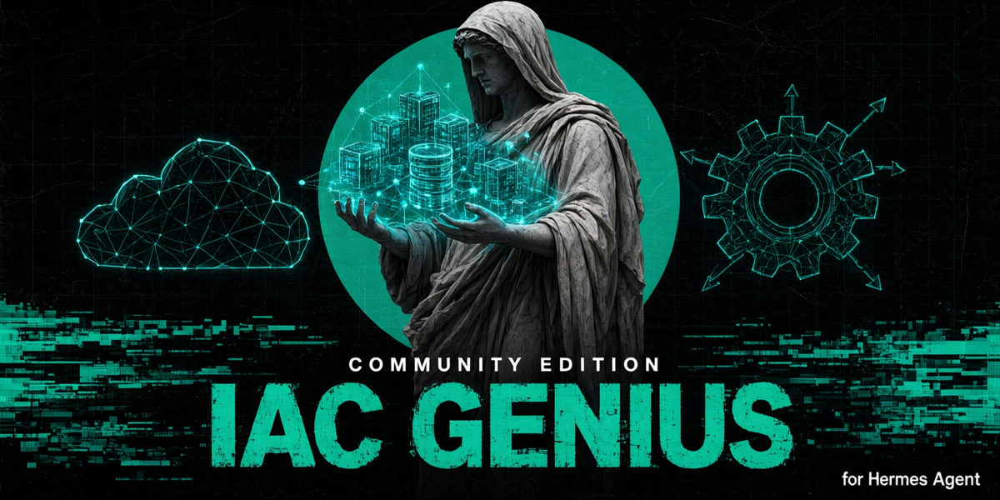

IaCGenius turns a plain-English request into validated Terraform (or OpenTofu) and a pull request you
can review. It runs on [Hermes Agent](https://github.com/NousResearch/hermes-agent). It **never applies
anything** and holds **no cloud credentials** — you stay the one who runs `terraform apply`, somewhere
else, after you have read the diff.

This guide walks you through it with real screenshots from a running installation: set it up, ask for
something, watch it validate, read the board, make the decisions, and finish with a PR or a download.
Everything shown here was captured from a live mission, not mocked up.

**Who this is for:** someone deploying their own Community Edition instance and using it day to day.
If you just want the commands, jump to [Run it](#1-run-it-on-one-instance). If you want to understand
the shape first, start with the picture below.

---

## The 30-second picture

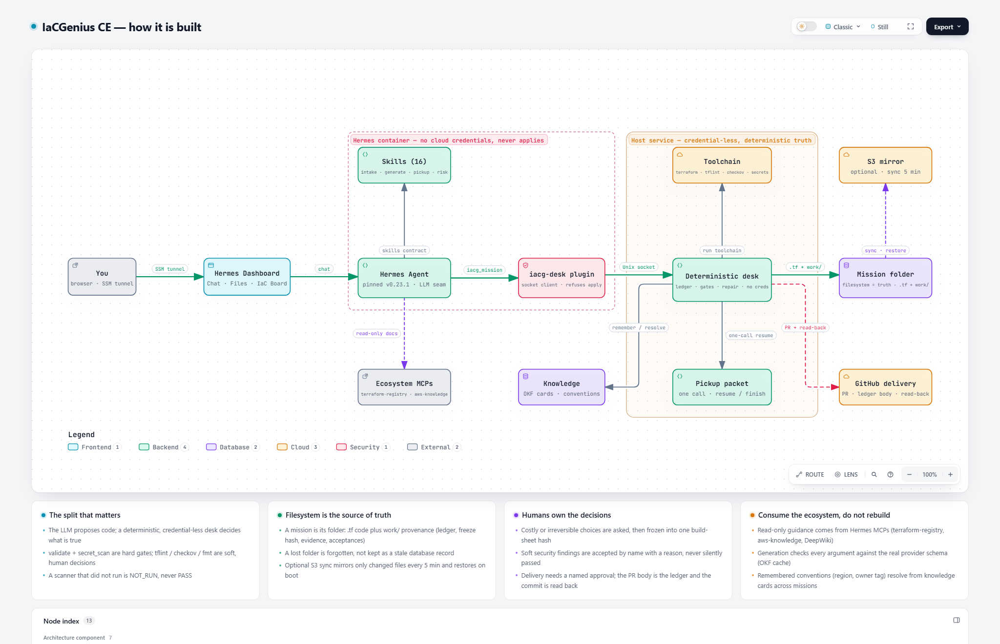

Three things are worth knowing before you touch anything:

- **The model proposes; a deterministic desk decides what is true.** The LLM writes code, but a small
  credential-less service (the *desk*) owns the decision ledger, runs the real validators, and keeps the
  evidence. No model output is trusted as a validation result.
- **Correctness blocks; security is your call.** `terraform validate` and the secret scan are *hard
  gates* — they must pass. `tflint`, `checkov` and `fmt` are *soft* — style and hardening choices you
  accept by name or fix. A scanner that did not run is marked `NOT_RUN`, never `PASS`.
- **Your work is a folder, and the filesystem is the truth.** Each mission is one folder: the `.tf` code
  plus a `work/` record of what was decided and who decided it. A lost folder is forgotten, not kept as a
  stale database row.

The diagram is interactive (zoom, trace the flow, read the source behind each box) in
[`media/diagrams/ce-architecture.html`](media/diagrams/ce-architecture.html).

---

## 1. Run it on one instance

The Community Edition deploys as **one EC2 instance** in an Auto Scaling group, a private S3 bucket for
state, and SSM-only access (no inbound port). The full Terraform is in
[`deploy/aws-single/`](../deploy/aws-single/README.md).

> **Use a persistent (on-demand) instance for your own CE.** A Spot instance can be reclaimed at any
> time. The optional [S3 sync](#7-your-work-kept-safe-and-durable) below makes Spot survivable, but
> on-demand is the simpler choice if you do not want interruptions.

**Before you begin:** Terraform ≥ 1.10, AWS CLI v2 with the Session Manager plugin, Python 3.11+, a
provisioning identity that can create IAM/S3/SG/launch-template/ASG, a subnet with outbound HTTPS, and
your model API key in Secrets Manager as a plain string.

```sh
python tools/package_release.py --spot dist/iacgenius-ce-spot.zip
cd deploy/aws-single
cp example.tfvars local.tfvars        # set account_id, subnet_id, source_zip, model_*
terraform init
terraform plan  -var-file=local.tfvars
terraform apply -var-file=local.tfvars
```

First boot installs Docker, pulls the **pinned** Hermes image, restores the Hermes home, seeds the model
and starts the gateway. The toolchain (terraform, tflint, checkov) and a shared provider cache install
once at onboarding and are reused — no per-mission provider downloads.

**Open the dashboard** over an SSM port-forward to `http://127.0.0.1:9126`. The login is in
`/data/hermes/iacgenius-login.json` on the instance. You land in the `iacgenius` profile:

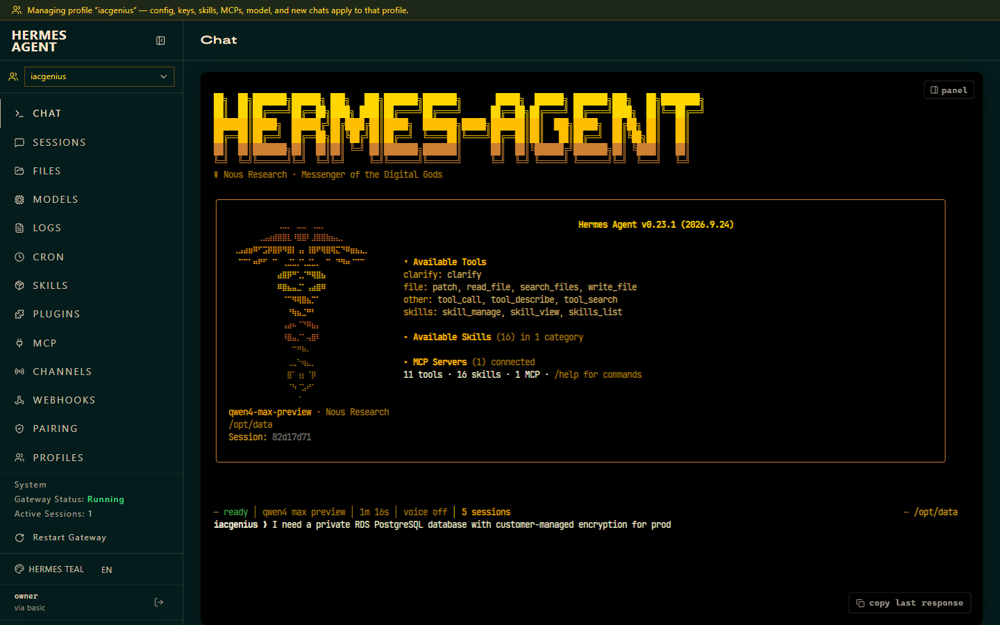

The banner tells you what is loaded: **16 skills, 1 MCP, 11 tools**, on the pinned Hermes `v0.23.1`.
Chat is where you talk to IaCGenius; the **IaC Board** tab is where you watch missions; the **Files** tab
is where you read and download the code.

**Warm the toolchain once.** In chat, ask IaCGenius to onboard. It reports the terraform / tflint /
checkov / provider versions and waits for you to confirm by name; reruns reuse the cache without
downloading. Onboarding is conversational — there is no separate wizard screen.

---

## 2. Say what you want

Type the request in plain English. For example:

> *I need a private RDS PostgreSQL database with customer-managed encryption for prod.*

IaCGenius writes down what you said in a **decision ledger**, then asks only the few questions that
actually cost money or cannot be undone (`MUST_ASK`). Everything else it settles from a provider-neutral
catalogue and from your [remembered conventions](#it-remembers-your-conventions) — disclosed defaults,
not guesses. It pins the Terraform and provider versions and checks every resource argument against the
real provider schema (`terraform providers schema -json`) instead of guessing.

When the scope is settled it freezes a **build sheet** with one hash, confirmed by your name. Generation
runs only on that frozen revision, so nothing drifts silently.

### It remembers your conventions

Tell IaCGenius once that your region is `us-east-1`, or your naming prefix, owner tag, or retention
policy, and it stops asking. Declared facts are kept as small **knowledge cards** (Open Knowledge Format,
with who said it and when) and reused across missions. A new stack resolves your region from knowledge
instead of asking again. You can still override any of them per mission by saying so.

```text
remember our region is us-east-1
remember tagging.owner is platform-team
show my knowledge
forget region
```

This is not cosmetic. In the live mission used for this guide, the owner tag `platform-team` was declared
once as knowledge — and the generated `main.tf` carries it straight into the resource tags:

```hcl
locals {
  common_tags = {
    Project     = "iacg-rds-private"
    Environment = "prod"
    ManagedBy   = "iacg-ce"
    Owner       = "platform-team"   # <- resolved from a knowledge card, not re-asked
  }
}
```

---

## 3. Watch it build and validate

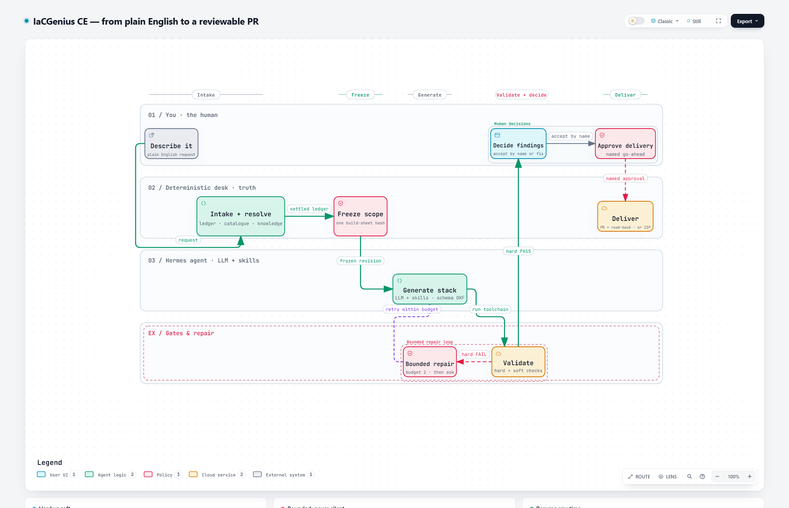

After the freeze, IaCGenius generates the stack and runs the toolchain. The journey, and where it can
branch:

- **Hard gates** — `terraform validate` and the secret scan. If either fails, IaCGenius repairs within a
  **fixed budget** (2 attempts), re-runs the checks, and if it still cannot fix something it **stops and
  asks you**. It will not loop forever.
- **Soft findings** — `tflint`, `checkov`, `fmt`. These go to you. Review each one and either fix it or
  **accept it by name** with a reason. Accepting is a recorded decision, not a silent pass.

Here is the real validation evidence from the guide's mission (`work/evidence.json`), exactly as the
desk recorded it — tool, version, status, findings:

```jsonc
{
  "validate":    { "status": "PASS", "tool": "terraform",        "version": "1.15.9", "findings": [] },
  "secret_scan": { "status": "PASS", "tool": "iacg-secret-scan", "version": "0.1.0",  "findings": [] },
  "tflint":      { "status": "PASS", "tool": "tflint",           "version": "0.64.0", "findings": [] },
  "fmt":         { "status": "PASS", "tool": "terraform",        "version": "1.15.9", "findings": [] },
  "checkov":     { "status": "FAIL", "tool": "checkov",          "version": "3.3.16", "findings": [
    { "id": "CKV_AWS_157", "message": "Ensure that RDS instances have Multi-AZ enabled", "severity": "medium" }
    // …4 more hardening findings, each named
  ]}
}
```

The code is **valid** (both hard gates pass). The `checkov FAIL` is a set of hardening *choices* — for
example Multi-AZ — that are yours to accept or fix. That distinction is the whole point.

---

## 4. Read the board

Open the **IaC Board** tab. Each mission card tells you where it stands:

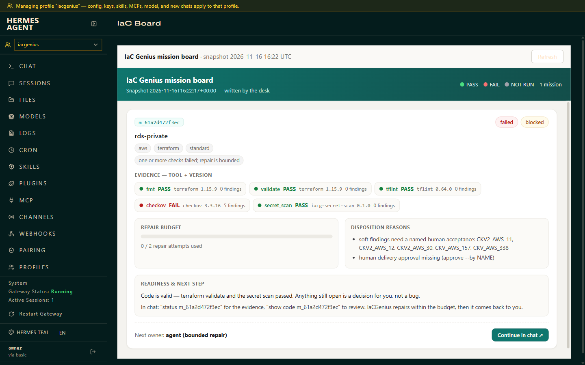

Reading the real card above:

- **Evidence chips** — one per check, with the tool and version that ran. Green `validate PASS` and
  `secret_scan PASS` are the hard gates; red `checkov FAIL · 5 findings` is soft.
- **Repair budget** — `0 / 2 repair attempts used`. No automatic fix was needed; the code validated.
- **Disposition reasons** — exactly what is still open: *"soft findings need a named human acceptance":
  CKV2_AWS_11, CKV2_AWS_12, CKV2_AWS_30, CKV_AWS_157, CKV_AWS_338*, and *"human delivery approval
  missing"*.
- **Readiness & next step** — a plain-language line: *"Code is valid — terraform validate and the secret
  scan passed. Anything still open is a decision for you, not a bug."*

> **A card can say `failed` while the code is perfectly valid.** That label means "not yet delivered
> because a decision is pending", not "the Terraform is wrong". Read the hard gates and the readiness
> line, not the colour of the state badge.

The board is grounded in the filesystem: a mission whose folder is gone simply does not appear. The
snapshot timestamp and **Refresh** button are shown top-right; Refresh asks the desk to re-render from
its durable store (the board also polls once a minute).

---

## 5. Investigate and decide

In chat, ask for what you want to see (use the mission id from the card):

```text
show code m_61a2d472f3ec        # the generated .tf files, exactly as written
status m_61a2d472f3ec           # the evidence, the gate, and what is blocking
show the ledger for m_61a2d472f3ec   # every decision and where it came from
```

Or browse the **Files** tab. To decide a soft finding, accept it by name with a reason:

```text
accept CKV_AWS_157 for m_61a2d472f3ec: single-AZ is intentional for this non-critical prod replica
```

That acceptance is recorded in `work/acceptances.json` with your name and reason. The generation itself
is driven by a registry of skills you can inspect on the **Skills** tab — intake, generate, pickup, risk,
status, wrapup, plus the cloud and IaC craft skills:

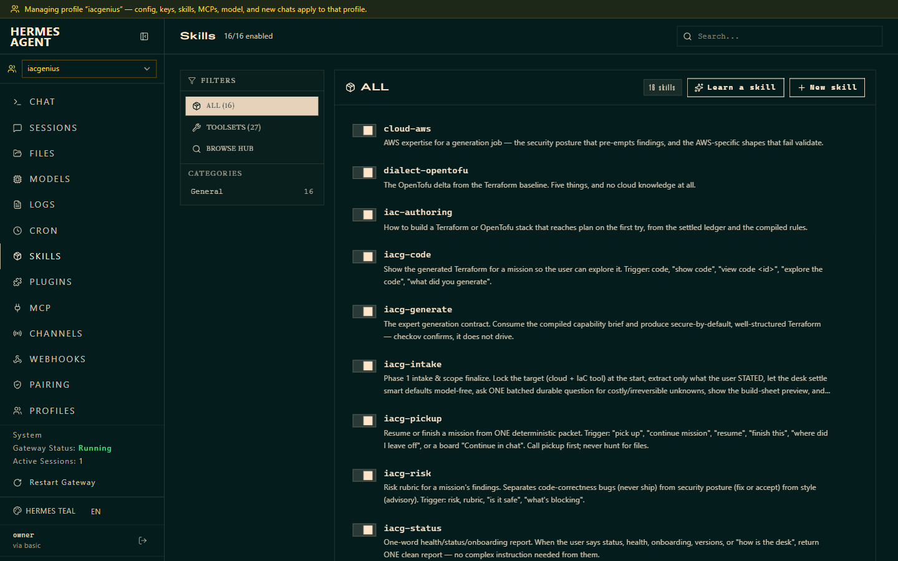

External capability comes from the **Hermes ecosystem**, not from re-implemented code. The connected
`terraform-registry` MCP supplies read-only provider docs; more (aws-knowledge, DeepWiki, GitHub/GitLab)
are one click away in the Nous-approved catalog:

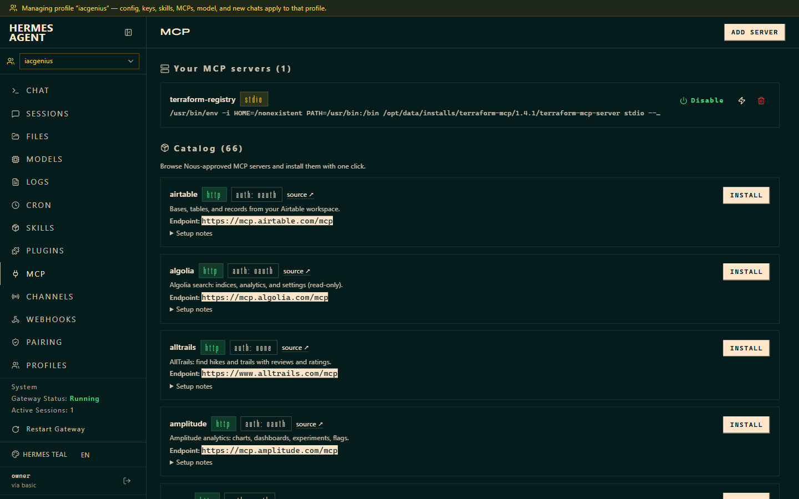

---

## 6. Finish: a PR or a download

Once the hard gates pass and the soft findings are decided:

1. **Approve delivery** — *"Approve delivery for m_61a2d472f3ec"* (in your name). This is the human
   go-ahead; without it the gate refuses.
2. Then either:
   - **Deliver a PR** — *"Deliver m_61a2d472f3ec to owner/repo."* IaCGenius opens a pull request whose
     body is the decision ledger, and **reads the commit back** to confirm it landed. (Delivery needs a
     GitHub token configured; without one it reports `NOT_RUN` rather than pretending.)
   - **Download your work** — *"Package m_61a2d472f3ec."* This zips the whole mission folder; download
     it from the Files tab and apply it yourself, wherever you like.

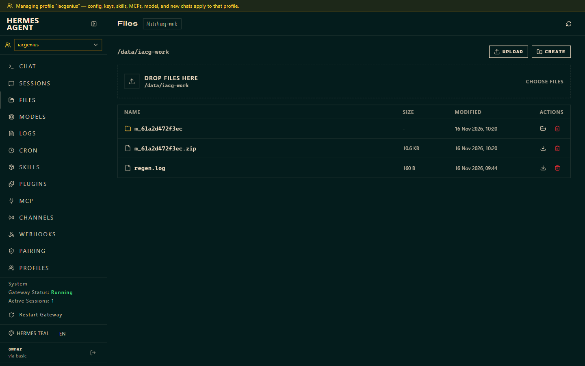

IaCGenius never runs `terraform apply`. Applying is always yours to do, elsewhere, after you have
reviewed the diff.

---

## 7. Your work, kept safe and durable

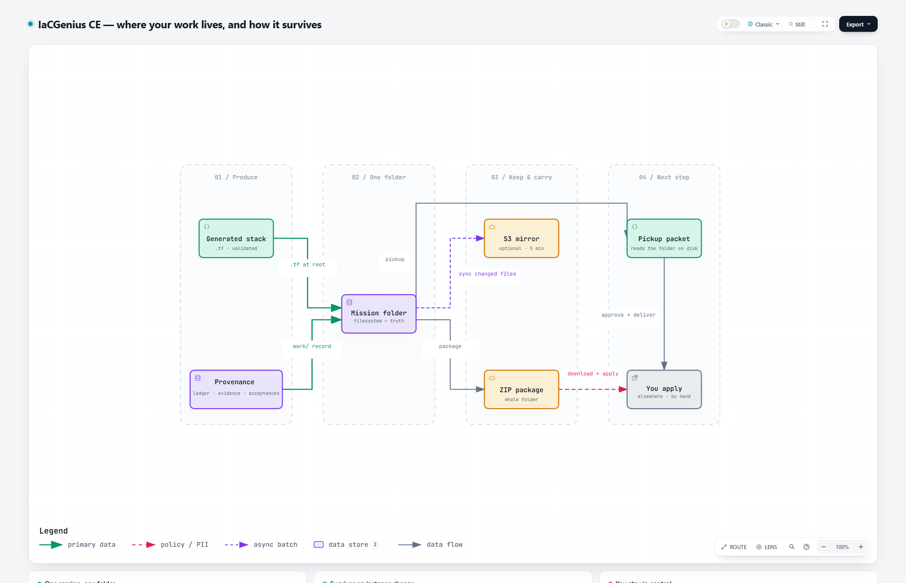

Each mission is **one folder**. The generated `.tf` files sit at the top; a separate `work/` folder keeps
what was finalized and who did what:

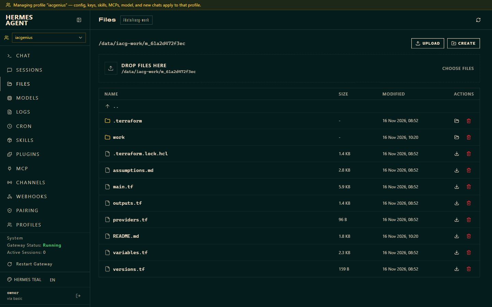

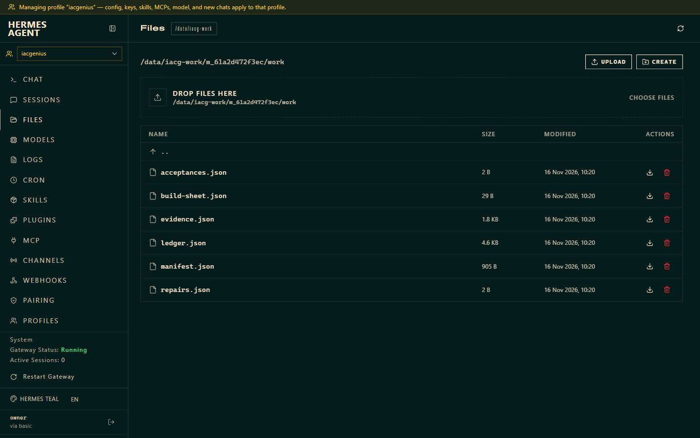

- `ledger.json` — every decision with its origin: `STATED` (you said it), `SOURCE` (a disclosed default),
  or `MUST_ASK` (costly/irreversible, asked), plus the source and rationale.
- `build-sheet.json` — the frozen scope, its one hash, and who confirmed it.
- `evidence.json` — which tool ran, its version, and the status/findings.
- `acceptances.json` — named human acceptances (who accepted what, and why).
- `repairs.json` — the bounded repair attempts spent.
- `manifest.json` — the session↔folder map, revision, and a resume hint.

A `README.md` in the folder explains how to pick it up again. `package` zips the whole folder (minus
provider binaries) so you can download it from the Files tab and explore it offline.

### Optional: survive an instance change

By default a lightweight checkpoint mirrors state to S3 every 2 minutes. **For durable, incremental
mirroring of the actual work, set `s3_sync = true`** in the instance `config.json`
(`/opt/iacgenius/config.json`) and re-run `host.py`. This switches the checkpoint to `aws s3 sync`, which
transfers **only changed files** (unchanged files are never re-transmitted), every **5 minutes**:

| Local | Mirrored to |
|---|---|
| `/data/iacg-work` (mission folders) | `s3://<bucket>/live/work/` |
| `/data/iacg` (desk DB, knowledge, schema cache) | `s3://<bucket>/live/iacg/` |
| `/data/hermes/profiles` (profile + skills) | `s3://<bucket>/live/profiles/` |

On boot, `host.py` syncs these back down, so a replacement instance recovers what was there. Enable this
if you run on Spot, or want your work to survive an instance change. To force a sync now:
`systemctl start iacgenius-checkpoint.service`. Full steps are in
[`deploy/aws-single/README.md`](../deploy/aws-single/README.md#state-durability-optional-incremental-s3-sync).

---

## 8. Pick it up later

A later session does not hunt for state. Ask IaCGenius to **pick up** a mission and it returns one
complete packet — state, whether the tree is on disk, the settled ledger, the evidence, the gate, the
repair budget, and the exact next step. For the guide's mission the packet ends with:

```text
next_step: "Code is valid; soft findings need a named human decision. Review each finding,
            accept by name with a reason or fix it, then approve delivery."
```

If the tree is gone, the packet says so up front and points to regeneration from the frozen ledger
instead of letting the agent search. Change a decision and re-confirm to freeze a new revision; your
remembered conventions carry forward unless you override them for a special request.

---

## What it never does

- Run `terraform apply` / `tofu apply`, or call any cloud write API.
- Use cloud credentials. Validation needs none.
- Claim a scan passed when it did not run.

## Quick reference

| You want to… | Say in chat |
|---|---|
| See the code | `show code <id>` |
| See evidence + gate | `status <id>` |
| See decisions | `show the ledger for <id>` |
| Resume / finish | `pickup <id>` |
| Accept a soft finding | `accept <finding-id> for <id>: <reason>` |
| Approve delivery | `approve delivery for <id>` |
| Open a PR | `deliver <id> to owner/repo` |
| Download a ZIP | `package <id>` |
| Remember a convention | `remember our region is us-east-1` |
| Review conventions | `show my knowledge` |
| Override for one mission | `special request — use eu-west-1 for this one` |

---

*Early build (0.1.0). It proposes validated code and a reviewable PR; it does not apply infrastructure.
The deeper user path — board → investigate → decide → finish → resume — is in
[`WORKFLOW.md`](WORKFLOW.md). Deployment details are in
[`deploy/aws-single/README.md`](../deploy/aws-single/README.md).*